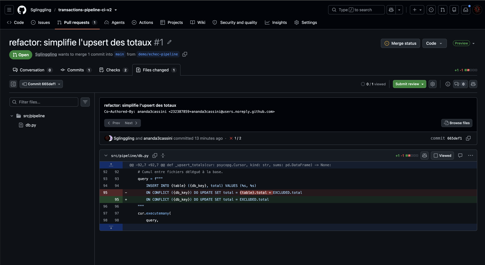
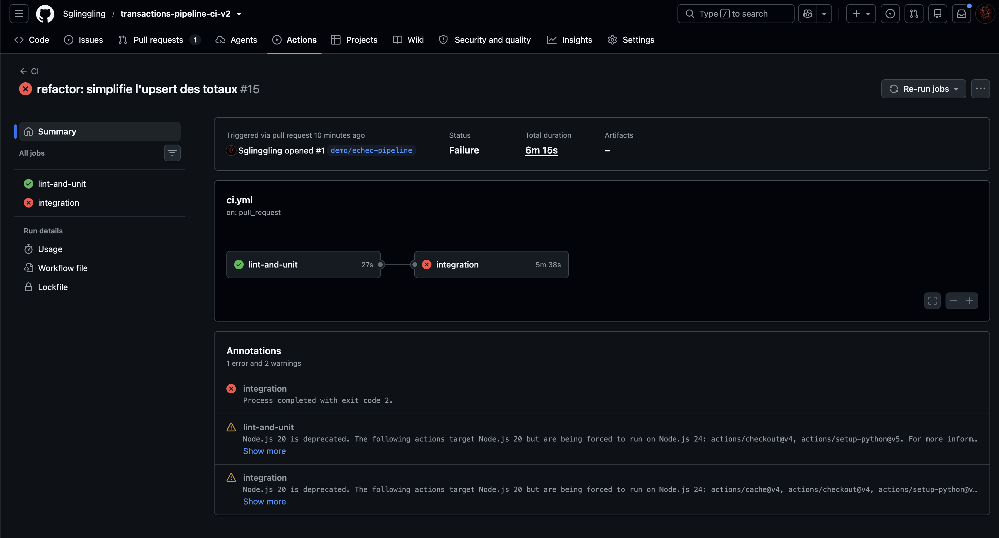
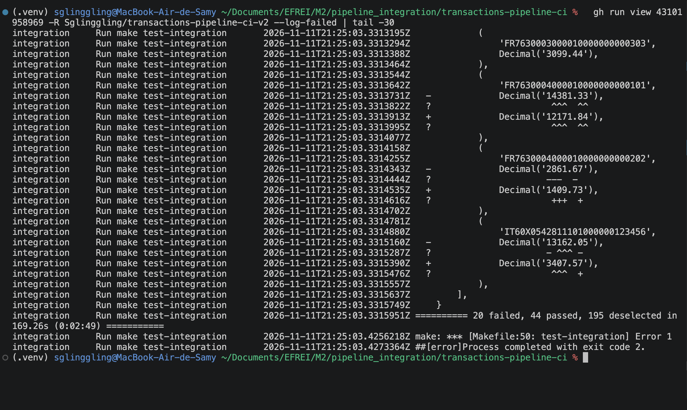
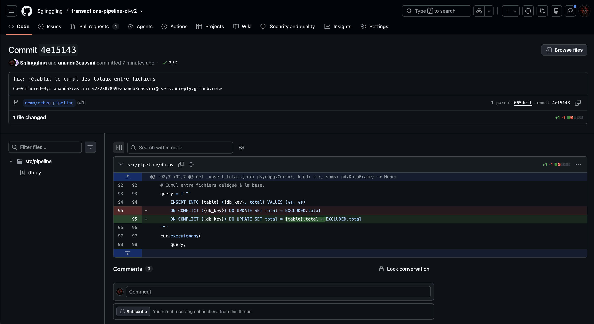
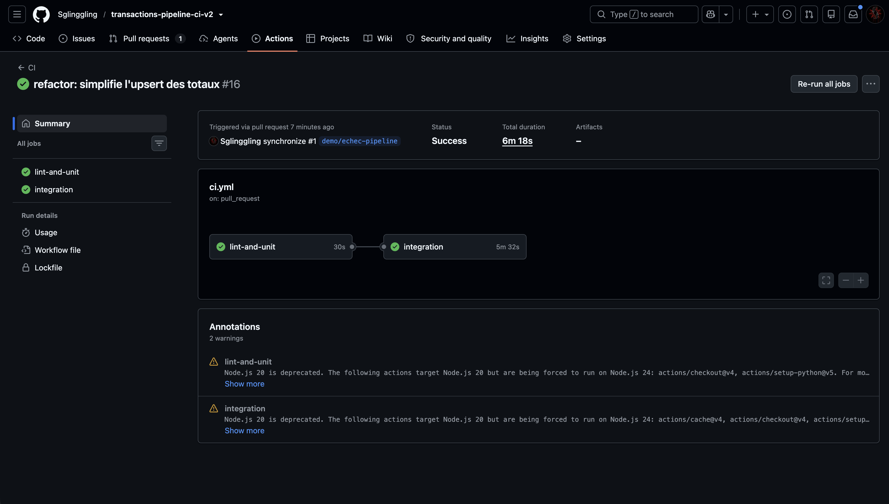
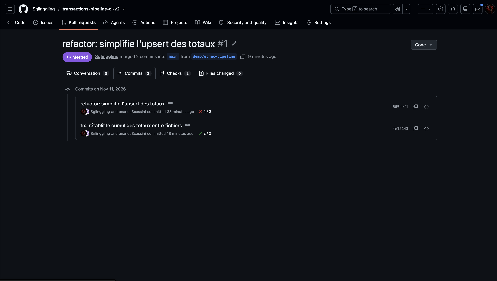

# Scénario d'échec de la pipeline CI

Démonstration documentée : une régression introduite lors d'un « refactor »
passe le lint et les tests unitaires, mais est bloquée par les tests
d'intégration de la CI avant d'atteindre `main`.

- Pull request : [#1 refactor: simplifie l'upsert des totaux](https://github.com/Sglinggling/transactions-pipeline-ci/pull/1)
- Branche : `demo/echec-pipeline`

## Contexte

La pipeline traite des transactions (CSV, images, textes) et alimente trois
tables de totaux (`total_sent_by_iban`, `total_sent_by_bank`,
`total_received_by_iban`). Les sommes **par fichier** sont calculées par les
fonctions pures de `processing.py` ; le **cumul entre fichiers** est délégué à
la base, via un upsert dans `db.py` :

```sql
INSERT INTO total_sent_by_iban (iban, total) VALUES (%s, %s)
ON CONFLICT (iban) DO UPDATE SET total = total_sent_by_iban.total + EXCLUDED.total
```

La CI GitHub Actions (`.github/workflows/ci.yml`) tourne sur chaque push sur
`main` et sur chaque pull request, en deux jobs :

1. `lint-and-unit` : `make lint`, `make test` (tests unitaires, sans base) ;
2. `integration` (après le premier) : services (RustFS, PostgreSQL, Ollama),
   génération et upload des données, `make run`, `make pipeline` relancé,
   `make test-integration`, démos de retry, puis `make db-down`.

## Cause du problème

Commit [`665def1`](https://github.com/Sglinggling/transactions-pipeline-ci/commit/665def1)
`refactor: simplifie l'upsert des totaux` sur la branche
`demo/echec-pipeline`. En voulant « simplifier » la requête, le cumul a été
remplacé par un écrasement :

```diff
--- a/src/pipeline/db.py
+++ b/src/pipeline/db.py
@@ -92,7 +92,7 @@ def _upsert_totals(cur: psycopg.Cursor, kind: str, sums: pd.DataFrame) -> None:
     # Cumul entre fichiers délégué à la base.
     query = f"""
         INSERT INTO {table} ({db_key}, total) VALUES (%s, %s)
-        ON CONFLICT ({db_key}) DO UPDATE SET total = {table}.total + EXCLUDED.total
+        ON CONFLICT ({db_key}) DO UPDATE SET total = EXCLUDED.total
     """
     cur.executemany(
         query,
```

Conséquence : quand un IBAN ou une banque apparaît dans plusieurs fichiers,
seul le total du **dernier** fichier traité est conservé, au lieu de la somme
de tous les fichiers. Rien ne plante : les données sont simplement fausses.

Pourquoi les tests unitaires ne voient rien : les fonctions de
`processing.py` sont inchangées et toujours correctes (somme par fichier).
L'erreur est dans le SQL, que seuls les tests d'intégration exécutent contre
une vraie base PostgreSQL.

## Échec de la pipeline

- Run #15 (pull request) : [43101958969](https://github.com/Sglinggling/transactions-pipeline-ci/actions/runs/43101958969)

| Job | Résultat |
|---|---|
| `lint-and-unit` | ✅ succès en 27 s, 195 tests unitaires ([job](https://github.com/Sglinggling/transactions-pipeline-ci/actions/runs/43101958969/job/130795453682)) |
| `integration` | ❌ échec à l'étape **`make test-integration`** en 5 min 38 s ([job](https://github.com/Sglinggling/transactions-pipeline-ci/actions/runs/43101958969/job/130795696875)) |

Dans le job `integration`, `make run` et `make pipeline` réussissent (la
pipeline tourne sans erreur, ce qui rend le bug d'autant plus dangereux),
puis `make test-integration` échoue. Les étapes de démo du retry sont sautées
et l'arrêt des services s'exécute quand même (`if: always()`).

La pull request affiche le commit du bug avec une croix rouge (1 check sur 2
réussi) : la régression est visible avant le merge.



*Figure 1 — PR #1 (statut « Open »), onglet « Files changed » : le commit
`665def1` porte une croix rouge (1 check sur 2 réussi) ; le diff montre la
ligne 95 de `src/pipeline/db.py`, où `{table}.total + EXCLUDED.total` devient
`EXCLUDED.total`.*



*Figure 2 — Résumé du run [#15](https://github.com/Sglinggling/transactions-pipeline-ci/actions/runs/43101958969)
(déclenché par l'ouverture de la PR) : statut « Failure », durée 6 min 15 s ;
`lint-and-unit` vert (27 s), `integration` rouge (5 min 38 s), annotation
« Process completed with exit code 2 ».*

## Message d'erreur obtenu

Extraits de `gh run view 43101958969 -R Sglinggling/transactions-pipeline-ci --log-failed`
(horodatages et colonnes job / étape retirés).

20 tests d'intégration échouent sur 64, tous sur les totaux :

```
tests/integration/test_db.py::test_totals_are_cumulated_across_files FAILED
tests/integration/test_pipeline.py::test_full_run FAILED
tests/integration/test_pipeline.py::test_does_not_depend_on_local_files FAILED
tests/integration/test_pipeline.py::test_second_run_inserts_nothing FAILED
tests/integration/test_pipeline.py::test_same_content_under_another_key_is_ignored FAILED
tests/integration/test_pipeline_images.py::test_mixed_run FAILED
tests/integration/test_pipeline_images.py::test_totals_cumulated_across_csv_and_image FAILED
tests/integration/test_pipeline_images.py::test_second_run_inserts_nothing FAILED
tests/integration/test_pipeline_images.py::test_same_image_under_another_key_is_ignored FAILED
tests/integration/test_pipeline_texts.py::test_full_run_three_sources_then_rerun FAILED
tests/integration/test_retry_pipeline.py::test_two_mid_failures_then_success FAILED
tests/integration/test_retry_pipeline.py::test_failure_after_commit_is_detected_as_already_processed FAILED
tests/integration/test_retry_pipeline.py::test_exhausted_retries_stop_pipeline_then_clean_rerun FAILED
tests/integration/test_s3_retry.py::test_two_s3_failures_then_success[connection] FAILED
tests/integration/test_s3_retry.py::test_two_s3_failures_then_success[timeout] FAILED
tests/integration/test_s3_retry.py::test_two_s3_failures_then_success[unavailable] FAILED
tests/integration/test_s3_retry.py::test_s3_retries_exhausted_then_clean_rerun FAILED
tests/integration/test_s3_retry.py::test_s3_and_db_failures_in_same_run[mid] FAILED
tests/integration/test_s3_retry.py::test_s3_and_db_failures_in_same_run[after_commit] FAILED
tests/integration/test_s3_retry.py::test_listing_is_retried FAILED
```

Le test le plus lisible, `test_totals_are_cumulated_across_files`, insère
deux fichiers ayant des IBAN et une banque en commun :

```
        assert insert(conn, FILE_A, "transactions_001.csv", HASH_A) is True
        assert insert(conn, FILE_B, "transactions_002.csv", HASH_B) is True

        assert row_counts(conn)["transactions"] == 5
>       assert totals(conn) == {
E       AssertionError: assert {'sent_by_iba...mal('0.20'))]} == {'sent_by_iba...'10000.21'))]}
E
E         Differing items:
E         {'sent_by_iban': [('DE89370400440532013000', Decimal('5000.01')), ('FR7630004000010000000000101', Decimal('0.10')), ('FR7630004000010000000000202', Decimal('5000.00')), ('IT60X0542811101000000123456', Decimal('0.20'))]} != {'sent_by_iban': [('DE89370400440532013000', Decimal('5000.01')), ('FR7630004000010000000000101', Decimal('12500.10')), ('FR7630004000010000000000202', Decimal('5000.00')), ('IT60X0542811101000000123456', Decimal('0.20'))]}
E         {'received_by_iban': [('DE89370400440532013000', Decimal('0.10')), ('ES9121000418450200051332', Decimal('12500.00')), ('FR7630004000010000000000101', Decimal('0.20'))]} != {'received_by_iban': [('DE89370400440532013000', Decimal('0.10')), ('ES9121000418450200051332', Decimal('12500.00')), ('FR7630004000010000000000101', Decimal('10000.21'))]}
E         {'sent_by_bank': [('BNP Paribas', Decimal('0.10')), ('Deutsche Bank', Decimal('5000.01')), ('UniCredit', Decimal('0.20'))]} != {'sent_by_bank': [('BNP Paribas', Decimal('17500.10')), ('Deutsche Bank', Decimal('5000.01')), ('UniCredit', Decimal('0.20'))]}
```

Valeurs attendues et obtenues (à gauche de `!=` : la base ; à droite :
l'attendu) :

| Table | Clé | Attendu (fichier A + B) | Obtenu | Explication |
|---|---|---|---|---|
| `total_sent_by_iban` | `FR7630004000010000000000101` | 12500.10 | 0.10 | 12500.00 (A) écrasé par 0.10 (B) |
| `total_sent_by_bank` | `BNP Paribas` | 17500.10 | 0.10 | 17500.00 (A) écrasé par 0.10 (B) |
| `total_received_by_iban` | `FR7630004000010000000000101` | 10000.21 | 0.20 | 10000.01 (A) écrasé par 0.20 (B) |

Les clés présentes dans un seul fichier (`DE89…`, `IT60…`, `Deutsche Bank`…)
ont la bonne valeur, ce qui confirme le diagnostic : seul le cumul est cassé.

Même constat de bout en bout (`test_full_run`, 3 fichiers générés) :
`BNP Paribas` vaut 6750.38 en base au lieu de 37144.15.

Fin du log :

```
========== 20 failed, 44 passed, 195 deselected in 169.26s (0:02:49) ===========
make: *** [Makefile:50: test-integration] Error 1
##[error]Process completed with exit code 2.
```



*Figure 3 — Sortie de `gh run view 43101958969 -R Sglinggling/transactions-pipeline-ci --log-failed | tail -30`
dans un terminal : fin du diff du dernier test en échec (totaux reçus
attendus, lignes `-`, contre totaux obtenus, lignes `+` : 14381.33 contre
12171.84, 2861.67 contre 1409.73, 13162.05 contre 3407.57), puis le résumé
« 20 failed, 44 passed, 195 deselected », l'erreur de `make` et
« Process completed with exit code 2 ».*

## Correction

Commit [`4e15143`](https://github.com/Sglinggling/transactions-pipeline-ci/commit/4e15143)
`fix: rétablit le cumul des totaux entre fichiers`, sur la même branche. Il
rétablit l'addition de la valeur existante et de la nouvelle (`EXCLUDED`)
dans la clause `ON CONFLICT` ; aucun test n'a été modifié :

```diff
--- a/src/pipeline/db.py
+++ b/src/pipeline/db.py
@@ -92,7 +92,7 @@ def _upsert_totals(cur: psycopg.Cursor, kind: str, sums: pd.DataFrame) -> None:
     # Cumul entre fichiers délégué à la base.
     query = f"""
         INSERT INTO {table} ({db_key}, total) VALUES (%s, %s)
-        ON CONFLICT ({db_key}) DO UPDATE SET total = EXCLUDED.total
+        ON CONFLICT ({db_key}) DO UPDATE SET total = {table}.total + EXCLUDED.total
     """
     cur.executemany(
         query,
```

Vérifié en local avant de pousser : `make test-integration` → 64 passed.



*Figure 4 — Page du commit [`4e15143`](https://github.com/Sglinggling/transactions-pipeline-ci/commit/4e15143)
sur GitHub (checks 2/2, parent `665def1`) : un seul fichier modifié,
`src/pipeline/db.py`, ligne 95 rétablie de `total = EXCLUDED.total` vers
`total = {table}.total + EXCLUDED.total`.*

## Réussite après correction

- Run #16 (pull request, « synchronize ») : [43104563108](https://github.com/Sglinggling/transactions-pipeline-ci/actions/runs/43104563108)

| Job | Résultat |
|---|---|
| `lint-and-unit` | ✅ succès en 30 s ([job](https://github.com/Sglinggling/transactions-pipeline-ci/actions/runs/43104563108/job/130804374166)) |
| `integration` | ✅ succès en 5 min 32 s ([job](https://github.com/Sglinggling/transactions-pipeline-ci/actions/runs/43104563108/job/130804664967)) |

Toutes les étapes du job `integration` passent, y compris les démos du retry
qui avaient été sautées lors de l'échec. Extraits du log :

```
================ 64 passed, 195 deselected in 131.99s (0:02:11) ================
```

```
WARNING Tentative 1/4 échouée (incoming/transactions_001.csv) : panne simulée 1/2 (point mid) — nouvelle tentative dans 1.0 s
WARNING Tentative 2/4 échouée (incoming/transactions_001.csv) : panne simulée 2/2 (point mid) — nouvelle tentative dans 2.0 s
INFO    Résumé : 3 traité(s), 0 déjà traité(s), 0 en erreur, 0 non examiné(s)
```



*Figure 5 — Résumé du run [#16](https://github.com/Sglinggling/transactions-pipeline-ci/actions/runs/43104563108)
déclenché par la PR (« synchronize ») après le push du correctif : statut
« Success », durée 6 min 18 s ; `lint-and-unit` (30 s) et `integration`
(5 min 32 s) verts. Le titre affiché est celui de la PR.*

La pull request est repassée au vert puis a été mergée en merge commit
(`52f6fd6`, pas de squash) pour garder visibles dans l'historique de `main`
le commit du bug puis celui de la correction. Le run de `main` après la
fusion (#17) est vert : [43105929408](https://github.com/Sglinggling/transactions-pipeline-ci/actions/runs/43105929408).



*Figure 6 — PR #1 au statut « Merged » (2 commits fusionnés dans `main`),
onglet « Commits » : le commit du bug `665def1` porte une croix rouge (1/2),
le correctif `4e15143` une coche verte (2/2).*

Ce que montre le scénario : la régression ne cassait ni le lint, ni les tests
unitaires, ni même l'exécution de la pipeline (`make run` et `make pipeline`
réussissaient) ; seuls les tests d'intégration, avec des valeurs attendues
écrites en dur et une vraie base PostgreSQL, l'ont détectée, et la CI l'a
bloquée avant `main`.
